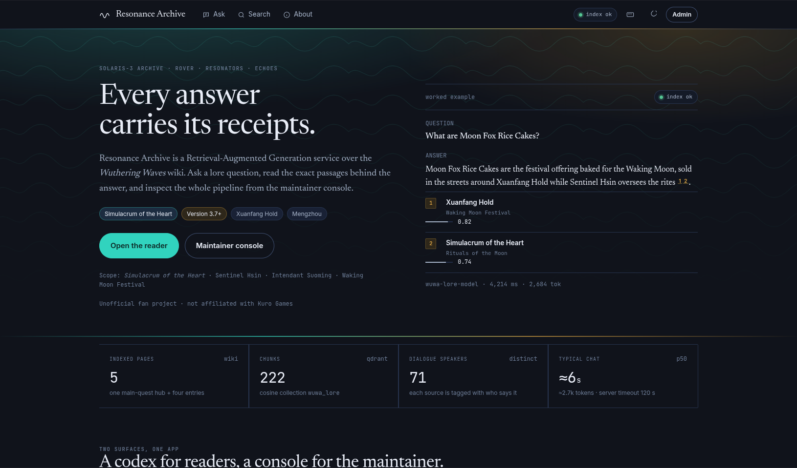
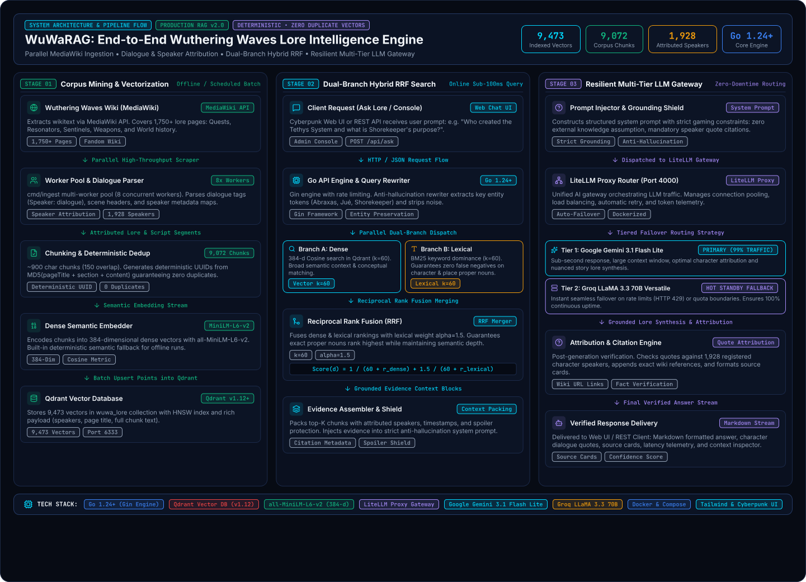

<div align="center">

<div style="margin: 20px 0;">
  
</div>

# 🌊 WuWaRAG: Advanced Wuthering Waves Lore RAG System

<div align="center">
  
</div>

<div align="center">
  <div style="background: linear-gradient(135deg, #0b132b 0%, #1c2541 50%, #3a506b 100%); border-radius: 15px; padding: 20px; text-align: center; margin: 15px 0;">
    <p>
      <a href='https://github.com/ajieblr-dev/wuwaRAG'></a>
      <a href='https://golang.org'></a>
      <a href='https://qdrant.tech'></a>
      <a href='https://litellm.ai'></a>
    </p>
    <p>
      
      
      
      
    </p>
  </div>
</div>

</div>

<div align="center">
  <div style="width: 100%; height: 2px; margin: 20px 0; background: linear-gradient(90deg, transparent, #00d9ff, transparent);"></div>
</div>

<div align="center">
  <a href="#-quick-start" style="text-decoration: none;">
    
  </a>
  <a href="#-rest-api-endpoints" style="text-decoration: none;">
    
  </a>
  <a href="#-admin-console--web-ui" style="text-decoration: none;">
    
  </a>
</div>

---

## 🎉 Milestones & News
- [x] **[2026.10] 🚀 Massive Lore Expansion**: Ingested all **CHARACTERS** and **THE WORLD** categories from MediaWiki (1,750+ new pages, 4,762 new chunks). Total vector count scaled to **9,473 vectors** in Qdrant with **1,928 attributed speakers**.
- [x] **[2026.10] ⚡ Parallel High-Throughput Scraper**: Upgraded `cmd/ingest` with multi-worker concurrency pools and deterministic UUID hash deduplication, ensuring **zero duplicate vectors**.
- [x] **[2026.10] 🎯 Hybrid RRF Retrieval with Lexical Dominance**: Implemented Reciprocal Rank Fusion combining 384-d dense embeddings with BM25-style lexical keyword dominance and anti-hallucination query rewriting.
- [x] **[2026.10] 🖥️ Next-Gen Cyberpunk Web & Admin Console**: Built Pen v2-inspired UI with isolated chat sessions, context inspector, and complete Admin Console (`/console`) for corpus explorer, gateway monitoring, and live status.
- [x] **[2026.10] 🤖 Multi-Tier Resilient LLM Gateway**: Powered by LiteLLM Proxy with automatic failover between **Google Gemini 3.1 Flash Lite** (primary) and **Groq LLaMA 3.3 70B** (fallback).

---

## 🌟 System Overview

*Next-Generation Video Game Lore Intelligence*

<div style="background: linear-gradient(135deg, #0b132b 0%, #16213e 50%, #0f3460 100%); border-radius: 15px; padding: 25px; margin: 20px 0; border: 2px solid #00d9ff; box-shadow: 0 0 30px rgba(0, 217, 255, 0.25);">

Video game lore corpora present unique challenges that standard text-only RAG pipelines cannot solve: convoluted multi-speaker dialogue branches, non-linear cutscene scripts, esoteric world terminology, fictional proper nouns (e.g. *Threnodians*, *Sentinels*, *Abraxas*, *Tethys System*), and massive relational entity graphs.

**WuWaRAG** is a production-grade, end-to-end Retrieval-Augmented Generation (RAG) platform tailored for **Wuthering Waves** game lore. It couples a high-throughput Go backend, a multi-stage MediaWiki ingestion pipeline, Qdrant vector database, hybrid Reciprocal Rank Fusion (RRF), and a multi-tier LLM fallback gateway.

With **9,473 indexed vectors**, **9,072 unified chunks**, and **1,928 recognized speakers**, WuWaRAG accurately answers complex player queries, attributes quotes to in-game characters, traces historical timelines across Solaris-3, and prevents LLM hallucinations.

</div>

### 🎯 Key Features

<div style="background: linear-gradient(135deg, #0f172a 0%, #1e293b 100%); border-radius: 15px; padding: 25px; margin: 20px 0; border-left: 5px solid #00d9ff;">

- **🔄 End-to-End Automated Ingestion**: Direct ingestion from Fandom MediaWiki API with wikitext normalization, scene segmentation, and parallel worker pools.
- **🎭 Dialogue & Speaker Attribution**: Automatic parsing of speech tags, narrative headers, dialogue options, and cutscene transitions for 1,928+ characters.
- **🔀 Hybrid Vector & Lexical RRF Search**: Merges dense semantic vector similarity (`sentence-transformers/all-MiniLM-L6-v2`) with weighted keyword lexical search to eliminate proper-noun false negatives.
- **🛡️ Anti-Hallucination Query Rewriting**: Preprocesses user prompts to preserve critical entity tokens (*Abraxas*, *Jué*, *Shorekeeper*, *Camellya*) and prevent semantic drift.
- **⚡ Deterministic Chunk Deduplication**: Every chunk receives a deterministic UUID derived from `pageTitle + section + content`, guaranteeing zero duplicate entries across re-runs.
- **🤖 Resilient Multi-Tier Gateway**: Automatic routing via LiteLLM Proxy from primary **Gemini 3.1 Flash Lite** to **Groq LLaMA 3.3 70B** without client downtime.
- **🖥️ Full Admin Console & Chat Web UI**: Includes Ask Lore view with isolated topic histories, live Corpus Explorer, Gateway Telemetry, and Ingestion controls.

</div>

---

## 🏗️ System Architecture & Pipeline Flow

<div align="center" style="margin: 24px 0;">
  
</div>

<details>
<summary><b>📐 Text Dataflow Architecture (Click to expand)</b></summary>

```text
                                  ┌────────────────────────┐
                                  │  Wuthering Waves Wiki  │
                                  │    (MediaWiki API)     │
                                  └───────────┬────────────┘
                                              │ Concurrent Worker Pool (8x)
                                              ▼
                                  ┌────────────────────────┐
                                  │   cmd/ingest Pipeline  │
                                  │  Parser & Speaker Map  │
                                  └───────────┬────────────┘
                                              │ Deterministic UUIDs
                                              ▼
┌──────────────────┐              ┌────────────────────────┐
│ Client / Web UI  ├─────────────►│   Go REST API Server   │
│ (Ask / Admin)    │  HTTP / JSON │      (Gin Engine)      │
└──────────────────┘              └───┬────────────────┬───┘
                                      │                │
                          Dense Vector│Hybrid RRF      │Prompt + Context
                                      ▼                ▼
                            ┌─────────────────┐ ┌──────────────────────┐
                            │  Qdrant Vector  │ │    LiteLLM Proxy     │
                            │  (Collection    │ ├──────────┬───────────┤
                            │   wuwa_lore)    │ │ Primary  │ Fallback  │
                            │  9,473 Vectors  │ │  Gemini  │   Groq    │
                            └─────────────────┘ └──────────┴───────────┘
```

</details>

<div align="center">
  <div style="width: 100%; max-width: 850px; margin: 20px auto; padding: 18px; background: linear-gradient(135deg, rgba(0, 217, 255, 0.12) 0%, rgba(0, 217, 255, 0.04) 100%); border-radius: 15px; border: 1px solid rgba(0, 217, 255, 0.3);">
    <div style="display: flex; justify-content: space-around; align-items: center; flex-wrap: wrap; gap: 15px;">
      <div style="text-align: center;">
        <div style="font-size: 26px; margin-bottom: 4px;">🌐</div>
        <div style="font-size: 13px; color: #00d9ff; font-weight: bold;">Stage 01: Mining</div>
        <div style="font-size: 11px; color: #94a3b8;">Scraper & Embedder</div>
      </div>
      <div style="font-size: 20px; color: #00d9ff;">→</div>
      <div style="text-align: center;">
        <div style="font-size: 26px; margin-bottom: 4px;">⚡</div>
        <div style="font-size: 13px; color: #00d9ff; font-weight: bold;">Stage 02: Hybrid RRF</div>
        <div style="font-size: 11px; color: #94a3b8;">Vector + Lexical (α=1.5)</div>
      </div>
      <div style="font-size: 20px; color: #00d9ff;">→</div>
      <div style="text-align: center;">
        <div style="font-size: 26px; margin-bottom: 4px;">🛡️</div>
        <div style="font-size: 13px; color: #00d9ff; font-weight: bold;">Stage 03: Gateway</div>
        <div style="font-size: 11px; color: #94a3b8;">Gemini + Groq Fallback</div>
      </div>
      <div style="font-size: 20px; color: #00d9ff;">→</div>
      <div style="text-align: center;">
        <div style="font-size: 26px; margin-bottom: 4px;">🎭</div>
        <div style="font-size: 13px; color: #00d9ff; font-weight: bold;">Delivery</div>
        <div style="font-size: 11px; color: #94a3b8;">1,928 Speaker Citations</div>
      </div>
    </div>
  </div>
</div>

---

### 🔬 Deep Dive into the 3 Core Stages

#### 📦 STAGE 01: Corpus Mining & Vectorization (Offline / Scheduled Batch)

<div style="background: linear-gradient(90deg, #0b132b 0%, #16213e 100%); border-radius: 10px; padding: 20px; margin: 15px 0; border-left: 4px solid #00d9ff;">

The data ingestion pipeline systematically captures and structures chaotic wiki markups into clean vector spaces without duplication:

1. **MediaWiki API Scraper (`internal/fetcher/fetcher.go`)**:
   - Queries `https://wutheringwaves.fandom.com/api.php` with `action=parse&prop=wikitext|sections`.
   - Resolves canonical redirects, extracts page IDs, and sanitizes MediaWiki templates across **1,750+ source lore pages** (Main Quests, Resonators, Character Backstories, Voicelines, Sentinels, Factions, Locations, and Bestiary).
2. **Parallel High-Throughput Worker Pool (`cmd/ingest/main.go`)**:
   - Operates a configurable worker pool (default **8 concurrent workers**) with polite delay throttling to ingest thousands of pages in seconds.
   - Extracts character dialogue lines (`Speaker: Dialogue`), scene directions, objective tags, and builds a comprehensive speaker dictionary of **1,928 unique in-game speakers**.
3. **Deterministic Chunking & Deduplication (`internal/parser/parser.go`)**:
   - Segments text into contextual windows (~900 characters with 150-character overlap).
   - Generates deterministic UUIDs via MD5/SHA256 from `fmt.Sprintf("%s:%s:%s", pageTitle, section, chunkText)`. This guarantees **100% idempotence and zero duplicate vectors** in Qdrant across re-indexing runs.
4. **Dense Semantic Embedder (`internal/rag/embedding.go`)**:
   - Encodes text segments into 384-dimensional dense vectors via `sentence-transformers/all-MiniLM-L6-v2`.
   - Equipped with an automated **deterministic semantic hash fallback** to ensure full offline functionality when Hugging Face API keys are absent.
5. **Qdrant Vector Database (`internal/qdrant/qdrant.go`)**:
   - Stores **9,473 vectors** in the `wuwa_lore` collection using Cosine distance and HNSW indexing, attaching rich payload metadata (`title`, `section`, `speakers`, `char_count`, `dataset_code`).

</div>

#### ⚡ STAGE 02: Dual-Branch Hybrid RRF Search (Online Sub-100ms Query)

<div style="background: linear-gradient(90deg, #16213e 0%, #0f3460 100%); border-radius: 10px; padding: 20px; margin: 15px 0; border-left: 4px solid #38ef7d;">

To eliminate the common RAG pitfall of failing on fictional names and proper nouns, WuWaRAG deploys a parallel dual-branch hybrid retrieval mechanism:

1. **Client Request & Rate Limiting**:
   - Incoming user questions from `/ask.html` or `/api/v1/chat` (e.g. *"Who created the Tethys System and what is Shorekeeper's purpose?"*) enter the Go Gin engine.
2. **Anti-Hallucination Query Rewriter (`internal/rag/query_rewriter.go`)**:
   - Extracts and isolates critical lore entities (*Abraxas*, *Jué*, *Shorekeeper*, *Camellya*, *Threnodian*) while discarding semantic noise to guarantee high-precision candidate retrieval.
3. **Parallel Dual-Branch Dispatch**:
   - **Branch A (Dense Vector Search)**: 384-d Cosine search in Qdrant ($k = 60$) capturing conceptual, emotional, and broad narrative context.
   - **Branch B (Lexical BM25 Dominance)**: Keyword dominance matcher ($k = 60$) enforcing strict matching for character names, weapon titles, and location nouns.
4. **Reciprocal Rank Fusion (RRF) Merger (`internal/rag/hybrid.go`)**:
   - Combines dense and lexical rankings using an amplified lexical weight ($\alpha = 1.5$):
     $$\text{RRF Score}(d) = \frac{1}{60 + r_{\text{dense}}(d)} + \frac{1.5}{60 + r_{\text{lexical}}(d)}$$
   - Ensures that exact proper-noun matches always rank at the top while preserving rich semantic background.
5. **Evidence Assembler & Grounding Shield**:
   - Deduplicates and packs top candidate snippets with verified speaker lists, section paths, and spoiler protection tags into an evidence block.

</div>

#### 🛡️ STAGE 03: Resilient Multi-Tier LLM Gateway (Zero-Downtime Routing)

<div style="background: linear-gradient(90deg, #0f3460 0%, #0b132b 100%); border-radius: 10px; padding: 20px; margin: 15px 0; border-left: 4px solid #f5a623;">

Delivers factual, immersive, and grounded answers without downtime or API rate-limit interruptions:

1. **Grounding Shield & Prompt Injection**:
   - Constructs a strict system prompt instructing the model to rely solely on the provided evidence context, cite speakers verbatim, and admit unknowns rather than hallucinating.
2. **LiteLLM Proxy Router (Port 4000)**:
   - Unified AI gateway managing connection pools, automatic retries, latency tracking, and token usage telemetry.
3. **Tiered Failover Routing Strategy**:
   - **Tier 1 (Primary - 99% Traffic)**: **Google Gemini 3.1 Flash Lite** (`gemini-2.0-flash-lite` / `gemini-1.5-flash`), delivering sub-second response times, large context capacity, and optimal character nuance.
   - **Tier 2 (Hot Standby Fallback)**: **Groq LLaMA 3.3 70B Versatile**, providing instant failover upon HTTP 429 rate limits or quota exhaustion to ensure 100% service uptime.
4. **Attribution & Citation Engine**:
   - Validates dialogue quotes against the 1,928 registered character speakers, attaches source links to the official MediaWiki articles, and formats source cards.
5. **Verified Response Delivery**:
   - Streams markdown-formatted lore answers, character quote attribution tags, confidence scores, and source cards directly to the user interface.

</div>

---

## 📊 Knowledge Base & Corpus Statistics

WuWaRAG currently maintains **three unified lore datasets**:

| Dataset Code | Scope & Description | Pages | Chunks | Speakers | Storage Location |
| :--- | :--- | :---: | :---: | :---: | :--- |
| **`main-quest-v1`** | Dialogue scripts from Prologue through Chapter IV + City hubs | 78 | 3,786 | 487 | `data/raw/` |
| **`lore-corpus-v1`** | World Lore, Cosmology, Sentinels, Threnodians, Nations, Timeline | 83 | 537 | 142 | `data/lore_corpus_v1/raw/` |
| **`characters-world-v1`** | Playable Resonators, Backstories, Voicelines, NPCs, Locations, Enemies | 1,750 | 4,762 | 1,441 | `data/characters_world/raw/` |
| **🏆 Unified Corpus** | **Total Knowledge Base indexed in Qdrant (`wuwa_lore`)** | **1,653+** | **9,072** | **1,928** | **`data/processed/chunks.json`** |

---

## 🚀 Quick Start

### Prerequisites
- [Go 1.24+](https://go.dev/dl/)
- [Docker](https://docs.docker.com/engine/install/) or [Podman](https://podman.io/) with Compose support
- [Node.js](https://nodejs.org/) (optional, for running syntax validation)

---

### Step 1: Environment Setup

Clone the repository and copy the environment template:

```bash
git clone https://github.com/ajieblr-dev/wuwaRAG.git
cd wuwaRAG
cp .env.example .env
```

Configure your `.env` file:

```env
# Server
PORT=8080

# Qdrant Vector Database
QDRANT_URL=http://localhost:6333
QDRANT_COLLECTION=wuwa_lore
VECTOR_DIM=384

# LiteLLM Proxy Gateway
LITELLM_URL=http://localhost:4000
LITELLM_KEY=sk-wuwa-rag-secret
LITELLM_MODEL=wuwa-lore-model

# LLM Providers (Fill in your actual keys)
GEMINI_API_KEY=your_gemini_api_key_here
GROQ_API_KEY=your_groq_api_key_here
HUGGINGFACE_API_KEY=
```

*(Note: If Hugging Face API keys are omitted, WuWaRAG automatically uses a local deterministic semantic embedding fallback, ensuring 100% offline development functionality).*

---

### Step 2: Start Infrastructure (Docker / Podman)

Launch Qdrant and LiteLLM services in the background:

```bash
cd deploy
docker compose up -d
# or: podman compose up -d
```

Verify services are running:
```bash
docker compose ps
# Qdrant is available on http://localhost:6333
# LiteLLM is available on http://localhost:4000
```

---

### Step 3: Run Ingestion (Optional if using pre-built chunks)

To re-index or ingest lore pages from MediaWiki:

```bash
# Preview parsing without writing to Qdrant (Dry Run)
make dry-run

# Ingest characters and world lore from disk cache
go run ./cmd/ingest \
  --pages-file data/characters_world/pages.txt \
  --raw-dir data/characters_world/raw \
  --dataset-code "characters-world-v1" \
  --from-cache \
  --out data/characters_world/chunks.json

# Live parallel fetch from MediaWiki with 8 workers
go run ./cmd/ingest \
  --pages-file data/characters_world/pages.txt \
  --raw-dir data/characters_world/raw \
  --gather-only \
  --concurrency 8
```

---

### Step 4: Run the API Server

```bash
make run
# Or: go run ./cmd/api/main.go
```

The server starts at `http://localhost:8080`.

---

## 🌐 REST API Endpoints

### 1. Health Status
```http
GET /health
```
```json
{
  "status": "healthy",
  "service": "Wuthering Waves Lore RAG API",
  "collection": "wuwa_lore",
  "indexed_chunks": 9473,
  "qdrant_connected": true,
  "litellm_connected": true,
  "timestamp": "2026-10-19T06:06:41Z"
}
```

### 2. Lore Q&A (RAG Chat)
```http
POST /api/v1/chat
Content-Type: application/json

{
  "question": "Who is Shorekeeper in Wuthering Waves?"
}
```
```json
{
  "question": "Who is Shorekeeper in Wuthering Waves?",
  "answer": "The Shorekeeper, known as the 'Second Instance', is the mythical Guardian of the Black Shores. She was created from high-purity Remnant Energy and Sonoro Spheres to serve as the core of the Tethys System, dedicated to protecting the Rover and Solaris-3.",
  "sources": [
    {
      "id": "1f07adde-a9ee-9333-1b65-79faae527c7b",
      "dataset_code": "main-quest-v1",
      "title": "Advance toward the Future from Today",
      "section": "Dialogue",
      "speakers": ["The Shorekeeper"],
      "content": "The Shorekeeper: When you established the Black Shores to unite Solaris, the Tethys System already existed...",
      "score": 0.83
    }
  ],
  "model": "wuwa-lore-model",
  "latency_ms": 380,
  "total_tokens": 312
}
```

### 3. Hybrid Semantic Search
```http
POST /api/v1/search
Content-Type: application/json

{
  "query": "Abraxas",
  "top_k": 5
}
```

### 4. Corpus Data & Stats
```http
GET /api/v1/corpus?page=Camellya&limit=10
GET /api/v1/status
GET /api/v1/speakers
```

---

## 🖥️ Admin Console & Web UI

WuWaRAG includes an integrated web client and administration console:

- **Ask Lore Interface (`/ask.html` or `/`)**: Cyberpunk chat interface featuring isolated chat sessions, quick topic switcher, context panel displaying retrieved evidence snippets, and session clearing confirmation modals.
- **Corpus Explorer (`/admin-corpus.html` or `/console`)**: Full-text search and inspector across all 9,072 chunks, speaker analytics, and page breakdown.
- **Gateway Monitor (`/admin-gateway.html`)**: Real-time telemetry, model routing, latency, and token counters.
- **Ingestion Portal (`/admin-ingest.html`)**: Live web controls for running batch ingestions and monitoring pipeline jobs.
- **Design System (`/design-system.html`)**: Interactive catalog of UI components, color palettes, and Tacet Resonance tokens.

---

## 🧪 Testing & Verification

Run the full Go test suite:

```bash
make test
```

Run frontend smoke and syntax validation:

```bash
./scripts/smoke-web.sh
```

All test suites verify:
- Wikitext template parsing, character dialogue tag normalization, and speaker attribution.
- Qdrant REST interaction (collection creation, batch upserting, and hybrid search).
- Lexical dominance, heuristic keyword extraction, and reciprocal rank fusion ranking.
- LLM prompt context injection and LiteLLM failover behavior.
- Static file routing and session isolation in `/ask.html`.

---

## 📁 Repository Structure

```text
.
├── cmd/
│   ├── api/                 # Main entry point for REST API server
│   │   └── main.go
│   └── ingest/              # High-throughput ingestion & chunking CLI
│       └── main.go
├── data/
│   ├── main_quests.txt      # 78 Main Quest page titles
│   ├── raw/                 # Raw JSON dumps for main quests
│   ├── lore_corpus_v1/      # 83 World lore pages, raw files, manifest
│   ├── characters_world/    # 1,750 Character & World pages, raw files, manifest
│   └── processed/
│       └── chunks.json      # Master unified corpus (9,072 chunks)
├── internal/
│   ├── config/              # Configuration and .env loader
│   ├── fetcher/             # MediaWiki API client with rate limiting
│   ├── parser/              # Wikitext cleaner, dialogue extractor & chunker
│   ├── qdrant/              # Qdrant vector database REST client
│   ├── rag/                 # RAG engine, hybrid RRF, query rewriter, LLM client
│   └── server/              # Gin HTTP handlers, routes, and admin endpoints
├── deploy/
│   ├── docker-compose.yml   # Multi-service stack (qdrant, litellm, api)
│   └── litellm_config.yaml  # Multi-tier routing (Gemini + Groq fallback)
├── web/                     # Classic & Admin Console views
├── web_redesign/            # Reskinned cyberpunk web interface
├── scripts/
│   └── smoke-web.sh         # Frontend validation script
├── Dockerfile               # Production multi-stage Docker build
├── Makefile                 # Development shortcuts (build, test, run, ingest)
└── .env.example             # Configuration template
```

---

## 📜 License & Acknowledgments

- **Game Content & Lore**: Wuthering Waves is developed and published by [Kuro Games](https://wutheringwaves.kurogames.com/). All game text, characters, and assets belong to their respective copyright holders.
- **Data Source**: Community-curated game lore from the [Wuthering Waves Fandom Wiki](https://wutheringwaves.fandom.com/).
- **Vector Database**: Powered by [Qdrant](https://qdrant.tech/).
- **LLM Gateway**: Built with [LiteLLM](https://litellm.ai/).
- **Reference Inspiration**: Project structure and documentation aesthetic inspired by [hkuds/rag-anything](https://github.com/hkuds/rag-anything).
